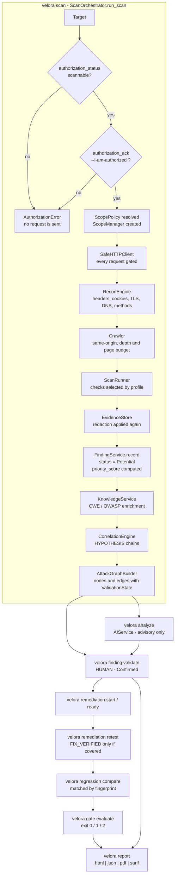

# Architecture

Velora is a CLI-first web assessment framework built around one rule: **deterministic
observation is the source of truth, and the AI layer only explains what was observed.**
The package layout encodes that rule. Scope enforcement sits at the bottom, deterministic
collection and detection sit above it, and the AI layer sits at the top as an advisory
consumer that cannot write back into the detection path.

This document describes what the code in `velora/` actually does. Where a stage is
operator-driven rather than automatic, that is stated.

## Dependency direction

The import graph below is what the code actually does, not an aspiration. Only
inter-package imports are shown.

| Package | Imports |
| --- | --- |
| `utils` | — |
| `scope` | `utils` |
| `models` | `utils` |
| `risk` | `models` |
| `correlation` | `models` |
| `database` | `config`, `models`, `utils` |
| `crawler` | `core`, `utils` |
| `fingerprint` | `core`, `utils` |
| `reconnaissance` | `core`, `fingerprint`, `utils` |
| `scanners` | `core`, `crawler`, `models`, `reconnaissance`, `scope`, `utils` |
| `evidence` | `database`, `models`, `scanners`, `utils` |
| `findings` | `database`, `evidence`, `models`, `risk`, `scanners`, `utils` |
| `knowledge` | `database`, `models`, `utils` |
| `attack_graph` | `correlation`, `database`, `models` |
| `differential` | `core`, `database`, `evidence`, `models`, `scanners`, `utils` |
| `authz` | `core`, `database`, `differential`, `evidence`, `findings`, `models`, `risk`, `scanners`, `utils` |
| `workflow` | `core`, `database`, `evidence`, `findings`, `models`, `risk`, `scanners`, `utils` |
| `plugins` | `database`, `models`, `scanners`, `utils` |
| `integrations` | `scope`, `utils` |
| `posture` | `database`, `models`, `scanners` |
| `regression` | `database`, `findings`, `models`, `utils` |
| `remediation` | `database`, `findings`, `models`, `utils` |
| `benchmark` | `database`, `findings`, `models`, `utils` |
| `reproduce` | `database`, `models`, `utils` |
| `gate` | `database`, `models`, `regression`, `utils` |
| `reporting` | `attack_graph`, `config`, `correlation`, `database`, `models`, `utils` |
| `ai` | `config`, `correlation`, `database`, `models`, `utils` |
| `planning` | `ai`, `database`, `models`, `scope`, `utils` |
| `core` | `attack_graph`, `config`, `correlation`, `crawler`, `database`, `findings`, `fingerprint`, `knowledge`, `models`, `reconnaissance`, `scanners`, `scope`, `utils` |
| `api` | `config`, `database`, `posture`, `reporting`, `scanners` |
| `cli` | almost everything |

Four properties of that graph carry the design.

**`scope` depends on nothing but `utils`.** The authorization boundary has no dependency
on models, on the database, or on anything that could be influenced by scan data. A
`ScopePolicy` cannot be widened by something a target returned, because the module that
decides has no way to see it.

**`ai` imports no detection code.** It reaches `config`, `correlation`, `database`,
`models` and `utils` — and nothing else. It has no import of `scanners`, `findings`,
`risk`, `evidence` or `attack_graph`. There is no path by which the AI layer changes a
finding's status, its severity, or its priority score, because it cannot reach the code
that sets them. Its one use of `correlation` is a local import inside
`AIService.correlate_findings()`, which runs the deterministic engine and returns its
output annotated `"hypothesis": True`.

**Only `cli` and `planning` import `ai`.** `planning` uses `ai.base.AIProvider` to have a
model *order and justify* a selection from a fixed capability catalog; `cli` invokes
`AIService` for `velora analyze`. Nothing in the scan path imports the AI layer at all.

**Nothing imports `cli`** except `velora/__main__.py`. Command-line concerns do not leak
into the engine.

Two places bend the shape, and both are worth knowing:

- **`velora/core` holds two very different things.** `core/http.py` is a low-level
  primitive that everything above it uses, while `core/orchestrator.py` is the top-level
  pipeline driver that imports `scanners`, `findings`, `knowledge`, `correlation` and
  `attack_graph`. The package therefore appears both near the bottom and near the top of
  the graph. `crawler`, `fingerprint`, `reconnaissance` and `scanners` import `core` for
  the HTTP client, not for the orchestrator.
- **`findings`, `workflow` and `authz` import `risk`.** Priority scoring is computed at
  the moment a finding is created rather than as a later pass, so the creating module
  calls `compute_priority()` directly.

Two boundaries are load-bearing.

**Every outbound request passes through `ScopeManager.authorize()`.** `SafeHTTPClient` in
`velora/core/http.py` calls it before each request and again on each redirect `Location`
header — redirects are never followed by httpx itself. A check, a plugin, a workflow step
and an authorization probe all receive the same already-gated client through
`ScanContext`, so none of them can widen the boundary. `velora/plugins/sdk.py` states this
explicitly: a plugin never gets its own HTTP client.

**Only `FindingService` may change a finding's lifecycle status.** Scanners emit
`CheckOutput`; `FindingService.record()` turns that into a `Finding` with
`status=FindingStatus.POTENTIAL`. The only path to `CONFIRMED` is
`FindingService.validate()`, called by `velora finding validate` — a human action.

## Packages

| Package | Purpose |
| --- | --- |
| `velora/ai` | Pluggable AI providers behind `AIProvider`; every result is clamped to `ai_generated=True`, `human_validation_required=True`. |
| `velora/api` | Read-only Starlette dashboard and JSON API. Launches no scans and mutates no findings. |
| `velora/attack_graph` | Builds the evidence-aware attack-surface graph and enumerates/explains paths through it. |
| `velora/authz` | Multi-identity authorization matrix: expected vs. observed access per identity × resource. |
| `velora/benchmark` | Ground-truth suites and measured accuracy metrics for Velora's own checks. |
| `velora/cli` | click command tree; the only interface that sends requests at a target. |
| `velora/config` | Typed settings with precedence environment > YAML > secure defaults. Secrets come from the environment only. |
| `velora/core` | `SafeHTTPClient`, the scan orchestrator, and the scope-policy factory. |
| `velora/correlation` | Deterministic rules that chain findings into attack-path *hypotheses*. |
| `velora/crawler` | Async, scope-bounded, same-origin crawler with depth and page budgets. |
| `velora/database` | SQLite connection, forward-only migrations, idempotent column additions, and the `Repository`. |
| `velora/differential` | Classifies structural differences between a baseline and a candidate exchange. |
| `velora/evidence` | Persists `EvidenceItem` as `Evidence`, re-applying redaction defensively. |
| `velora/findings` | Finding creation from check output, the human-validation workflow, and stable cross-scan fingerprints. |
| `velora/fingerprint` | Technology detection from HTTP responses. |
| `velora/gate` | CI/CD security gate: declarative policy → `PASS`/`FAIL`/`ERROR` decision and exit code. |
| `velora/integrations` | Argument-array adapters for nmap, OWASP ZAP and nuclei, scope-restricted and timeout-bounded. |
| `velora/knowledge` | CWE/OWASP catalog mapping, CVSS vector parsing, and the knowledge graph. Never fabricates CVE or CPE ids. |
| `velora/models` | Pydantic domain models and the enums (severity, confidence, `ValidationState`, gate decision, …). |
| `velora/planning` | Assessment planning constrained to a fixed capability catalog; every step starts `PROPOSED`. |
| `velora/plugins` | Plugin SDK 2.0 with validated metadata contracts, plus the 1.x `SecurityCheck` path and enable/disable state. |
| `velora/posture` | Velora Security Posture Score — an aggregate trend indicator, explicitly not CVSS. |
| `velora/reconnaissance` | Passive/low-touch collection: headers, cookies, TLS, DNS, methods, robots/sitemap, security.txt. |
| `velora/regression` | Scan-to-scan deltas matched by finding fingerprint. |
| `velora/remediation` | Remediation lifecycle and retest verification, conservative about coverage. |
| `velora/reporting` | Report context assembly and HTML/JSON/PDF/SARIF generation. |
| `velora/reproduce` | Secret-free reproducibility packages: versions, scope hash, redacted metadata, steps. |
| `velora/risk` | Velora Priority Score, a transparent triage metric held separate from CVSS. |
| `velora/scanners` | The `SecurityCheck` framework, registry, profile-aware runner, and the 11 built-in checks. |
| `velora/scope` | `ScopePolicy` (declarative, deny-by-default) and `ScopeManager` (runtime enforcement + SSRF guard). |
| `velora/utils` | Logging with a `SECURITY` level, secret redaction, URL normalization, typed errors, ids, console output. |
| `velora/workers` | `bounded_gather`, the in-process asyncio concurrency cap. No external task queue. |
| `velora/workflow` | Business-logic workflows as state machines, plus the step-skip probe. |

`velora/scanners` contains one subpackage per check family: `authentication`,
`authorization`, `configuration`, `cookies`, `headers`, `information_disclosure`,
`input_validation`, `tls`.

## The scan pipeline

`ScanOrchestrator.run_scan()` in `velora/core/orchestrator.py` is the automatic portion.
It runs authorization → scope → recon → crawl → checks → findings → knowledge enrichment →
correlation → attack graph, and stops there. Everything after that is a separate operator
command, deliberately: AI analysis is advisory, validation is a human act, and a gate
decision belongs to a pipeline, not to a scanner.



### Stage by stage

**Discover.** `ReconEngine` collects passive and low-touch signals for the target URL.
`Crawler` walks the same origin within `max_crawl_depth` and `max_crawl_pages`, recording
endpoints, parameters, forms and API-looking URLs. Both use the gated client, and the
crawler reports how many requests were `blocked`.

**Map.** `_persist_recon()` writes a `Host` row with the resolved addresses and a
`Technology` row per detection; `_persist_endpoints()` writes an `Endpoint` row per
discovered URL. This is the attack surface as observed, not as assumed.

**Assess.** `ScanRunner(profile=...)` selects checks via `registry.for_profile()`. A check
runs in the `safe` profile only if its class sets `safe_mode = True`; `standard` and `lab`
run all checks. Failures are isolated per check: a `ScopeViolation` or an unexpected
exception records an entry in `checks_failed` and the run continues, and a
`RateLimitExceeded` stops the run. The scan's `stats` reports `checks_run` and
`checks_failed`, so a missing detection can be distinguished from a check that never
executed.

Eleven checks are registered; ten run in the `safe` profile.

| Check id | Category | Class severity | `safe_mode` |
| --- | --- | --- | --- |
| `auth.indicators` | authentication | Medium | yes |
| `authz.consistency` | authorization | Medium | yes |
| `config.directory_exposure` | configuration | Medium | yes |
| `config.http_methods` | configuration | Low | yes |
| `config.security_txt` | configuration | Informational | yes |
| `cookies.attributes` | session | Medium | yes |
| `headers.security_headers` | configuration | Medium | yes |
| `headers.server_version` | information_disclosure | Low | yes |
| `infodisc.indicators` | information_disclosure | Medium | yes |
| `input.reflection` | input_validation | Low | no |
| `tls.configuration` | tls | Medium | yes |

**Collect evidence.** Each `CheckOutput` carries its own `EvidenceItem` list.
`EvidenceStore.persist()` runs `redact_mapping`, `redact_headers` and `redact_text` over
request metadata, response metadata, headers and the excerpt before writing the row. The
docstring states why the redaction is repeated here: so nothing sensitive is written even
if a check forgot to redact. Evidence is immutable once written.

**Risk.** Scoring happens inside `FindingService.record()`, not as a later pass.
`compute_priority()` produces the Velora Priority Score from severity, confidence,
exposure, asset importance, evidence quality and whether the category implies unauthenticated
reachability. Severity anchors the product, so an Informational finding cannot be scored
as high priority. CVSS, when a check supplied a vector, is stored separately on the
finding and never conflated with the priority score.

**Correlate.** `CorrelationEngine.correlate()` applies fixed category-pair rules over the
findings of one scan. Every `Correlation` carries `hypothesis = True`, and every rule's
description ends in "HYPOTHESIS — validate manually". The engine is deterministic; no AI
participates in creating a correlation.

**Attack graph.** `AttackGraphBuilder.build()` turns endpoints, technologies, hosts,
identities, authorization tests, findings and correlations into nodes and edges, each
carrying `confidence`, a `ValidationState`, its supporting `evidence_ids`, and the name of
the component that asserted it. See [ATTACK_GRAPH.md](ATTACK_GRAPH.md).

**AI analysis.** Separate command: `velora analyze --finding <id>`. `AIService` builds a
deterministic `EvidenceMatrix` first, then sends a sanitized `PromptEnvelope` to the
provider, then calls `enforce_safety(max_confidence=<matrix cap>)` on the result. The
provider cannot exceed the confidence the evidence supports, cannot set a finding status,
and cannot assert `ValidationState.VALIDATED` — `enforce_safety` downgrades that to
`HYPOTHESIZED`.

**Human validation.** `velora finding validate|reject|remediated`. `FindingService`
couples the lifecycle status to the epistemic state in `_STATE_FOR_STATUS`: `CONFIRMED`
sets `validation_state = VALIDATED`, `REJECTED` sets it to `UNKNOWN`. The comment in the
code gives the reason — confirming is the one action in Velora that produces `VALIDATED`,
so the two fields have to move together or the field stops recording what it claims to.

**Remediate and retest.** `RemediationService` walks `OPEN` →
`REMEDIATION_IN_PROGRESS` → `READY_FOR_RETEST` → `FIX_VERIFIED` / `FIX_FAILED`. A retest
that no longer detects the issue yields `FIX_VERIFIED` **only if the retest actually
covered the endpoint**. If coverage cannot be shown the result is inconclusive and the
remediation stays `READY_FOR_RETEST`. This is the principle stated as code: absence of a
detection is not evidence of a fix.

**Regression.** `RegressionEngine.compare()` matches findings across scans by
`Finding.fingerprint`, not by id. `REINTRODUCED_FINDING` requires history: present
earlier, absent in the previous scan, present again now — or a previously verified
remediation. Without that evidence the finding is simply `NEW_FINDING`.

**Gate.** `SecurityGate.evaluate()` returns `PASS` / `FAIL` / `ERROR`, whose
`exit_code` property is `0` / `1` / `2`. See [CI_CD.md](CI_CD.md).

**Report.** `ReportGenerator.generate()` writes `<scan_id>.json`, `<scan_id>.html`,
`<scan_id>.sarif` and `<scan_id>.pdf` into the output directory. A PDF request without
WeasyPrint logs a warning and writes HTML instead rather than failing silently. SARIF is
described in [SARIF.md](SARIF.md).

## Stages outside the orchestrator

These run as their own CLI groups against a stored scan or a target, and are not part of
`run_scan`:

| Command group | Module | What it does |
| --- | --- | --- |
| `velora authz` | `velora/authz` | Runs an identity × resource matrix and records expected vs. observed access. |
| `velora diff` | `velora/differential` | Compares two controlled exchanges and classifies the differences. |
| `velora workflow` | `velora/workflow` | Executes a declared business-logic state machine and probes step skips. |
| `velora plan` | `velora/planning` | Generates, reviews, approves and executes catalog-bounded assessment plans. |
| `velora posture` | `velora/posture` | Computes the Velora Security Posture Score and its trend. |
| `velora benchmark` | `velora/benchmark` | Measures Velora against ground truth. |
| `velora reproduce` | `velora/reproduce` | Builds a secret-free reproducibility package for a finding. |
| `velora engagement` | `velora/cli/commands/engagement.py` | Groups targets, identities, scans, findings and reports. |

## Key design decisions

**Deny-by-default scope with a runtime SSRF guard.** `ScopePolicy` is declarative and
requires a host to match an allowed domain or IP; `*.example.com` matches subdomains but
not the apex. `ScopeManager.authorize()` checks, in order: scheme, port, excluded path,
host in scope, address safety, request budget. The address check resolves the host and
requires every resolved address to be public and non-reserved unless
`allow_private_targets` is set, and cloud metadata addresses (`169.254.169.254`,
`fd00:ec2::254`, `100.100.100.200`) are always blocked. A blocked request raises
`ScopeViolation` and logs at the custom `SECURITY` level; it never silently continues.

**Exclusions survive path spelling.** `ScopePolicy.normalize_path()` decodes percent
encoding twice, folds `\` to `/`, resolves `.` and `..`, collapses duplicate slashes and
lowercases. An exclusion is the operator saying "do not touch this", so `/x/../admin`,
`/ADMIN` and `/%61dmin` have to hit the same rule.

**Redirects are re-authorized, not followed.** `SafeHTTPClient` reads the `Location`
header itself and re-checks it against the redirect policy and the full scope. An
in-scope page cannot bounce the scanner to an internal address.

**Response bodies have two limits.** `MAX_BODY_DOWNLOAD` (5 MB) is enforced while
streaming, because a hostile server is not obliged to send a truthful `Content-Length`;
`MAX_BODY_CAPTURE` (200 KB) bounds what is stored and parsed. `HttpResponse.truncated`
records when the download limit was hit, and the field's comment states the consequence:
a check reasoning about the *absence* of something in the body must treat a truncated
body as inconclusive.

**Findings start Potential; only a human confirms.** Stated in `velora/findings/service.py`
as the module's key invariant, and enforced by keeping the transition methods in one
service that neither the scanners nor the AI layer call.

**The AI is capped by deterministic evidence.** The order in `AIService` is
artifacts → `EvidenceMatrix` → `AnalysisInput` → `PromptEnvelope` → provider →
`enforce_safety(cap=matrix)` → persisted `AIAnalysis`. The matrix is computed before the
model is called, so the ceiling on the model's confidence is set by evidence rather than
by the model's own claim.

**The planner cannot invent capabilities.** `AIPlanner` asks a provider to order and
justify a selection from `velora/planning/capabilities.py`; anything outside that catalog
is discarded into `PlanDraft.discarded`. `tests/unit/test_workflow_planning.py` exercises
this with a provider that returns `exec:rm -rf /` and an exfiltration URL, and asserts
both are dropped. Steps are scope-checked at generation time and re-checked immediately
before execution, so narrowing scope after approval blocks execution.

**Unassessed is not the same as clean.** `SecurityPostureSnapshot.categories` is typed
`dict[str, float | None]`, and the field comment says a `None` category was not assessed
by this scan and is deliberately not collapsed to `0.0` or dropped, "because an unassessed
area must never read as either a failure or a clean bill of health."

**Fingerprints separate the issue from the run.** `velora/findings/fingerprint.py` hashes
check + category + method + normalized endpoint + normalized title. Object identifiers in
the path (`/api/orders/1`) collapse to `{id}`, the port is excluded, and severity is
excluded so a re-rated finding reads as *persisting* rather than as one fixed and one new.

**Rejected findings leave the comparison set.** `EXCLUDED_FROM_COMPARISON` holds
`FindingStatus.REJECTED`, and `index_by_fingerprint()` skips them by default, because
reporting a rejected finding as `PERSISTING` scan after scan would keep a false positive
alive in every report.

**Persistence is ORM-agnostic on purpose.** The bundled engine is stdlib `sqlite3` behind
`Repository`, whose `add_*` / `get_*` / `list_*` / `update_*` surface maps onto a
SQLAlchemy 2.0 session. A generic mapper converts Pydantic models to and from rows by
inspecting field annotations, so adding a model field needs no repository change once the
column exists. `velora/database/columns.py` adds columns idempotently through a
`PRAGMA table_info` check, because SQLite has no `ADD COLUMN IF NOT EXISTS` and a bare
`ALTER` in a migration would break on a partially-migrated database.

**Concurrency is in-process asyncio.** `velora/workers/pool.py` provides `bounded_gather`;
there is no Celery or external broker. The crawler fans out over a bounded worker pool;
`ScanRunner` executes checks sequentially so a report is reproducible.

**External tools run as argument arrays.** `velora/integrations/base.ToolAdapter` never
builds a shell string, resolves and validates the executable path, validates the target
against the scan's `ScopeManager` first, enforces a timeout that kills the child process
group, and caps captured output.

**The dashboard is read-only.** `velora/api/app.py` states it: the dashboard never
launches scans, never mutates findings and never makes a network request against a
target. Those actions live in the CLI, where scope enforcement, the authorization
acknowledgement and audit logging are.

## Testing

Run the suite with the bundled virtualenv:

```bash
cd /home/claude/velora
PYTHONPATH=.:tests/fixtures .venv/bin/python -m unittest discover -s tests -t . -p "test_*.py"
```

A single module runs the same way:

```bash
PYTHONPATH=.:tests/fixtures .venv/bin/python -m unittest tests.unit.test_attack_graph
```

`tests/` is organised as `unit/`, `integration/`, `security/` and `migration/`, with the
local lab application in `tests/fixtures/labapp.py`. The `security/` directory holds the
adversarial cases — SSRF, scope bypass, command injection, out-of-scope redirects, secret
redaction, prompt injection, resource limits and the authorization gate.
